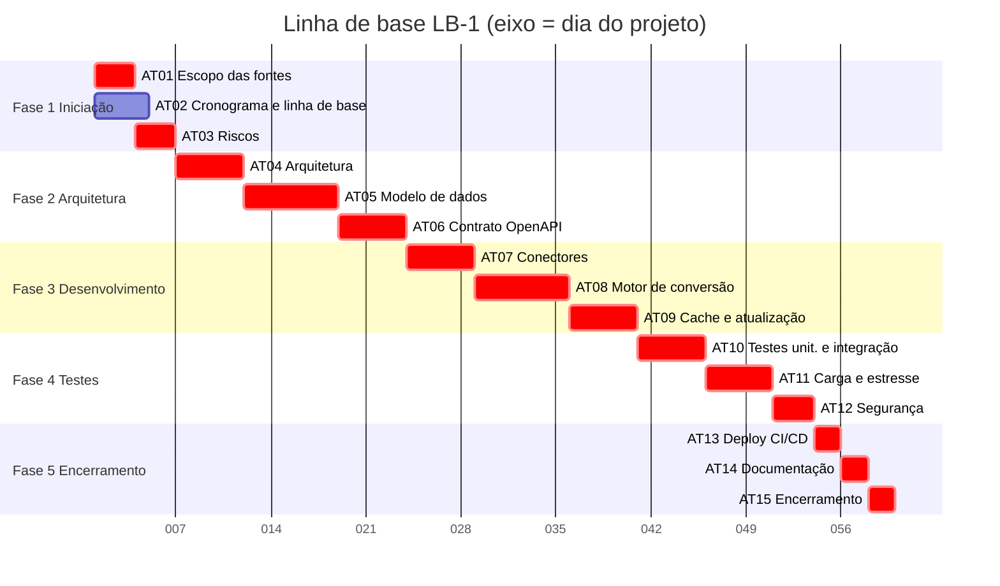

# AT02: Cronograma e linha de base

| Campo | Valor |
|---|---|
| Atividade | AT02, Elaborar documento de cronograma e linha de base |
| Unidade | dias de trabalho relativos (dia 1 = início do projeto); sem calendário, por decisão do patrocinador nesta etapa |
| Versão da linha de base | LB-1 (22/11/2026) |

## 1. Convenções adotadas

O documento original misturava convenções entre linhas. A linha de base usa uma só:

- **Início** = dia seguinte ao **maior fim** entre as predecessoras (ou dia 1, sem predecessora).
- **Fim** = início + duração − 1 (o dia de fim é trabalhado inteiro).
- Uma atividade de 5 dias que começa no dia 46 termina no dia 50, nunca no 51 nem no 53.
- Marcos (fases) têm duração = fim da última atividade − início da primeira + 1.

## 2. Linha de base (LB-1)

| ID | Atividade | Predecessora | Dias | Início | Fim | Folga | Crítica |
|---|---|---|---|---|---|---|---|
| AT01 | Mapear escopo inicial dos bancos de dados externos e das variáveis geopolíticas | - | 3 | 1 | 3 | 0 | Sim |
| AT02 | Elaborar documento de cronograma e linha de base | - | 4 | 1 | 4 | 55 | Não |
| AT03 | Identificar e analisar riscos geopolíticos e de integração com APIs de terceiros | AT01 | 3 | 4 | 6 | 0 | Sim |
| AT04 | Desenhar arquitetura técnica da API e infraestrutura de nuvem | AT03 | 5 | 7 | 11 | 0 | Sim |
| AT05 | Modelar banco de dados de índices históricos e econômicos | AT03, AT04 | 7 | 12 | 18 | 0 | Sim |
| AT06 | Definir contratos e endpoints da API (OpenAPI) | AT05 | 5 | 19 | 23 | 0 | Sim |
| AT07 | Desenvolver conectores para bancos externos | AT06 | 5 | 24 | 28 | 0 | Sim |
| AT08 | Implementar motor de conversão e ajuste geopolítico | AT07 | 7 | 29 | 35 | 0 | Sim |
| AT09 | Configurar cache e rotina de atualização de dados | AT07, AT08 | 5 | 36 | 40 | 0 | Sim |
| AT10 | Testes unitários e de integração (conectores e motor) | AT09 | 5 | 41 | 45 | 0 | Sim |
| AT11 | Testes de carga e estresse | AT10 | 5 | 46 | 50 | 0 | Sim |
| AT12 | Auditoria de segurança, criptografia e conformidade | AT11 | 3 | 51 | 53 | 0 | Sim |
| AT13 | Deploy em produção (CI/CD) | AT12 | 2 | 54 | 55 | 0 | Sim |
| AT14 | Publicar documentação técnica para desenvolvedores | AT13 | 2 | 56 | 57 | 0 | Sim |
| AT15 | Revisão final de encerramento e lições aprendidas | AT14 | 2 | 58 | 59 | 0 | Sim |

**Duração total da linha de base: 59 dias.** Soma bruta das durações: 63 dias (AT02 roda em paralelo com AT01 e AT03, por isso o total é menor).

A folga de AT02 (55 dias) é teórica: ninguém depende dela no cálculo. Na prática a linha de base (este documento) precisa estar aprovada antes da AT04, porque é ela que permite medir planejado × realizado. Ver a seção 5, decisão D2.

## 3. Caminho crítico

`AT01 → AT03 → AT04 → AT05 → AT06 → AT07 → AT08 → AT09 → AT10 → AT11 → AT12 → AT13 → AT14 → AT15` (59 dias)

Só AT02 está fora dele. Consequência: qualquer atraso em qualquer outra atividade atrasa o projeto inteiro no mesmo número de dias. As arestas AT03→AT05 e AT07→AT09 são redundantes (já implícitas por AT04 e AT08) e não mudam o cálculo.

## 4. Marcos (fases)

| Fase | Atividades | Início | Fim | Duração |
|---|---|---|---|---|
| 1. Iniciação e Planejamento | AT01 a AT03 | 1 | 6 | 6 |
| 2. Arquitetura e Modelagem | AT04 a AT06 | 7 | 23 | 17 |
| 3. Desenvolvimento e Integração | AT07 a AT09 | 24 | 40 | 17 |
| 4. Testes, Homologação e Segurança | AT10 a AT12 | 41 | 53 | 13 |
| 5. Implantação e Encerramento | AT13 a AT15 | 54 | 59 | 6 |

As durações das fases somam 59, igual ao total do projeto.

## 5. Diagrama de Gantt

O Mermaid exige datas. O diagrama ancora o dia 1 em 01/01 de um ano qualquer e mostra o eixo em "dia do ano" (`%j`), que coincide com o dia do projeto. As datas do código-fonte do diagrama não têm significado de calendário.

## 6. Correções em relação ao documento original

Fonte: "Gerenciamento de Cronograma - Grupo 2" (elaborado em 28/08/2026, GP Gabriel Resende). As atividades, predecessoras e durações do original foram mantidas; só o cálculo das datas mudou.

| ID | Duração | Predecessora | Original (início–fim) | LB-1 (início–fim) |
|---|---|---|---|---|
| AT01 | 3 | - | 1–3 | 1–3 |
| AT02 | 4 | - | 3–7 | 1–4 |
| AT03 | 3 | AT01 | 7–10 | 4–6 |
| AT04 | 5 | AT03 | 10–15 | 7–11 |
| AT05 | 7 | AT03, AT04 | 15–22 | 12–18 |
| AT06 | 5 | AT05 | 22–27 | 19–23 |
| AT07 | 5 | AT06 | 27–32 | 24–28 |
| AT08 | 7 | AT07 | 32–39 | 29–35 |
| AT09 | 5 | AT07, AT08 | 39–44 | 36–40 |
| AT10 | 5 | AT09 | 44–49 | 41–45 |
| AT11 | 5 | AT10 | 49–53 | 46–50 |
| AT12 | 3 | AT11 | 53–56 | 51–53 |
| AT13 | 2 | AT12 | 56–58 | 54–55 |
| AT14 | 2 | AT13 | 58–60 | 56–57 |
| AT15 | 2 | AT14 | 60–62 | 58–59 |

| # | Problema no original | Correção |
|---|---|---|
| C1 | Convenções misturadas: AT01 vai de 1 a 3 (fim inclusivo, 3 dias), mas as demais usam fim = início + duração, e cada atividade começa no mesmo dia em que a anterior termina (AT01 termina no 3 e AT02 começa no 3) | Convenção única da seção 1; nenhum dia contado duas vezes |
| C2 | AT11 tem 5 dias, mas vai do 49 ao 53 (4 dias pela subtração usada nas outras linhas) | AT11 nos dias 46 a 50 |
| C3 | AT02 não tem predecessora, mas foi encadeada depois de AT01, e AT03 (que depende só de AT01) começa no fim de AT02 (dia 7). Isso empurra o projeto inteiro em 4 dias | AT02 em paralelo desde o dia 1; AT03 logo após AT01 |
| C4 | Marcos com 10 + 17 + 17 + 13 + 6 = 63 dias, mas o projeto termina no dia 62; "Iniciação" com 10 dias inclui o atraso de AT02 | Marcos recalculados (seção 4): 6 + 17 + 17 + 13 + 6 = 59 |
| C5 | Total de 62 dias, que não bate com a soma dos marcos (63) nem com o caminho crítico | Total de 59 dias pelo caminho crítico |

## 7. Decisões

- **D1**: unidade em dias relativos. O patrocinador pediu a implementação completa em uma única entrega; quando houver calendário, basta mapear o dia 1 para uma data e excluir fins de semana e feriados.
- **D2**: AT02 sem predecessora formal (respeita o documento), mas com critério de gestão: a linha de base precisa estar aprovada antes do início da AT04.
- **D3**: mudança da linha de base só por solicitação de mudança registrada; a LB-1 fica preservada para o planejado × realizado da AT15.
