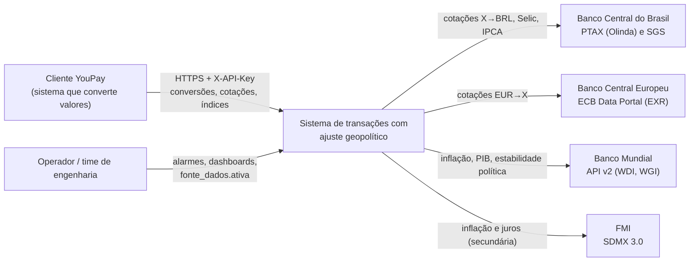
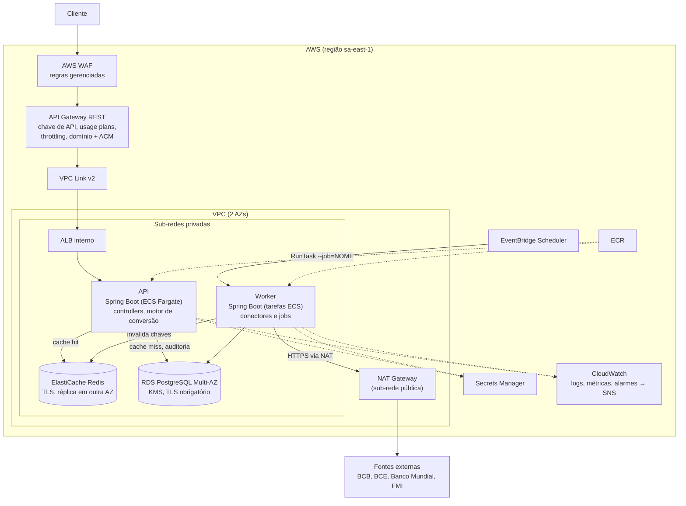
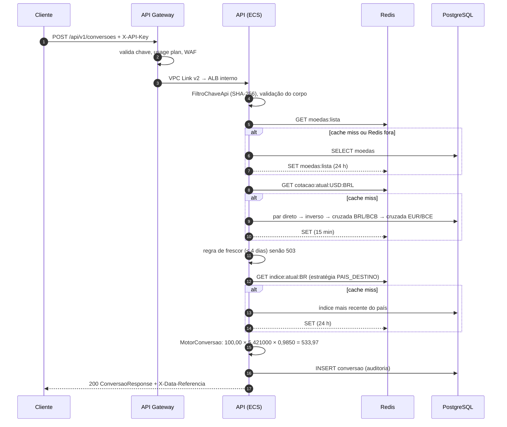
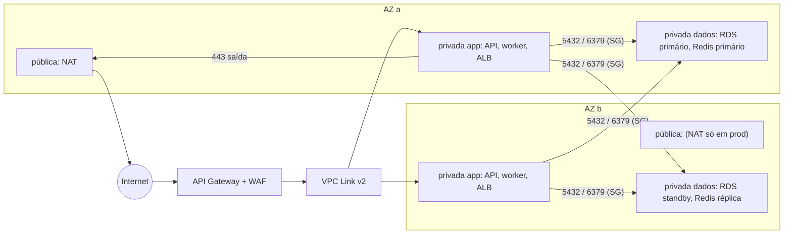

# AT04: Arquitetura técnica da API e da infraestrutura

Desenho da Fase 2 transformado em artefato versionado. Decisões em `docs/adr/`.

## 1. Contexto (C4 nível 1)



## 2. Contêineres (C4 nível 2)



| Contêiner | Tecnologia | Responsabilidade |
|---|---|---|
| API (`modulos/api`) | Java 21, Spring Boot 4.1, Spring MVC, virtual threads | 6 endpoints, validação, filtros de chave e limite, cache, auditoria |
| Domínio (`modulos/dominio`) | biblioteca | entidades, repositórios, `MotorConversao`, estratégias, `ResolvedorTaxaCambio`, cache |
| Conectores (`modulos/conectores`) | WebClient + Resilience4j | clientes BCB (PTAX, SGS), BCE, Banco Mundial, FMI |
| Worker (`modulos/worker`) | Spring Boot sem web | 5 jobs + migração, um por execução de tarefa ECS |
| Banco | RDS PostgreSQL 17 | 7 tabelas, `cotacao` particionada por mês |
| Cache | ElastiCache Redis 7 | cotações, índices, indicadores, moedas |

## 3. Sequência: conversão com ajuste



## 4. Sequência: atualização de cotações (worker)

```mermaid
sequenceDiagram
    participant E as EventBridge Scheduler
    participant W as Worker (tarefa ECS)
    participant F as Fonte (BCB/BCE)
    participant P as PostgreSQL
    participant R as Redis
    participant M as CloudWatch
    E->>W: RunTask --job=AtualizacaoCotacoesBcbJob
    W->>P: fonte_dados.ativa?
    W->>F: GET (timeout, retry com backoff, circuit breaker)
    F-->>W: JSON (valida valor, data, moeda; descarta inválidos)
    W->>P: INSERT ... ON CONFLICT DO NOTHING
    W->>R: apaga cotacao:atual:*
    W->>M: métricas (lidos, gravados, ignorados, descartados, falhas, duração)
    W-->>E: encerra com código 0 ou 1
```

## 5. Rede e segurança



| Security group | Entrada permitida |
|---|---|
| `vpclink` | nenhuma (só saída para o ALB) |
| `alb` | 80 do SG `vpclink` |
| `api` | 8080 do SG `alb` |
| `worker` | nenhuma |
| `rds` | 5432 dos SGs `api` e `worker` |
| `redis` | 6379 dos SGs `api` e `worker` |

Autoscaling da API por CPU (alvo 60%, mínimo 2 tarefas em prod). Código em `infra/`.
