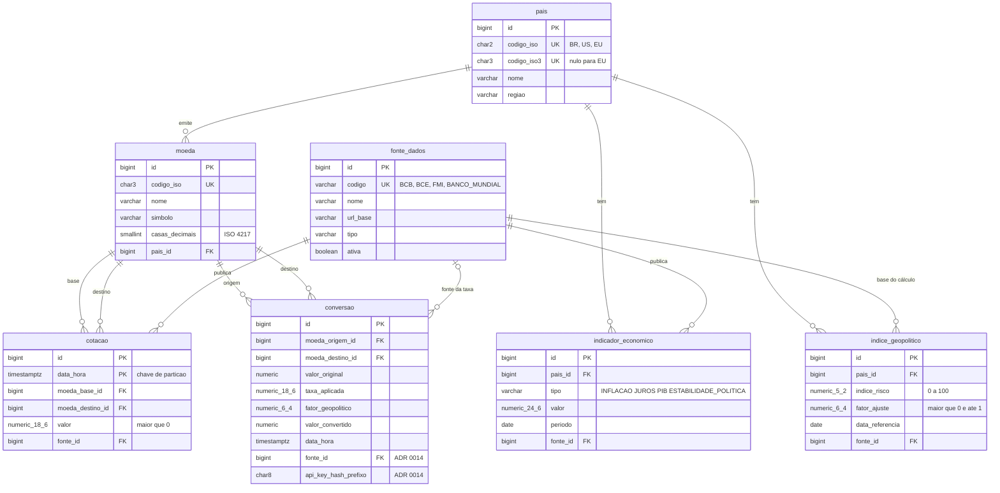

# AT05: Modelo de dados

Migrations em `db/migration` (Flyway, SQL puro). Testes em `modulos/dominio/.../MigracoesIntegracaoTest.java` (PostgreSQL limpo via Testcontainers).

## Migrations

| Arquivo | Conteúdo |
|---|---|
| `V1__schema_base.sql` | 7 tabelas, PK/FK, NOT NULL, CHECKs (risco 0–100, fator ∈ (0,1], valor > 0, tipo de indicador, padrões de código ISO); `cotacao` particionada por `data_hora` |
| `V2__particoes_cotacao.sql` | função `criar_particao_cotacao` (SECURITY DEFINER), partições de 24 meses antes a 3 depois, `DEFAULT` |
| `V3__indices.sql` | índices da especificação e unicidades de idempotência |
| `V4__dados_iniciais.sql` | 4 fontes, 15 países (10 com moeda + 5 da zona do euro), 10 moedas |
| `V5__papeis_permissoes.sql` | papéis `papel_api` e `papel_worker` com menor privilégio |

## Diferenças em relação ao modelo da Fase 2

| Mudança | Motivo | ADR |
|---|---|---|
| `TIMESTAMP` → `TIMESTAMPTZ` | ambiguidade de fuso | 0004 |
| PK de `cotacao` = `(id, data_hora)` | exigência de tabela particionada | 0012 |
| `moeda.casas_decimais` | arredondamento ISO 4217 | 0010 |
| `pais.codigo_iso3` | o FMI usa ISO alfa-3 | 0020 |
| `fonte_dados.codigo` | identificador estável usado pelo código | 0013 |
| `tipo = ESTABILIDADE_POLITICA` | guardar o PV bruto | 0005 |
| `conversao.fonte_id`, `api_key_hash_prefixo` | rastreabilidade | 0014 |
| Unicidades em indicador e índice | idempotência | 0013 |
